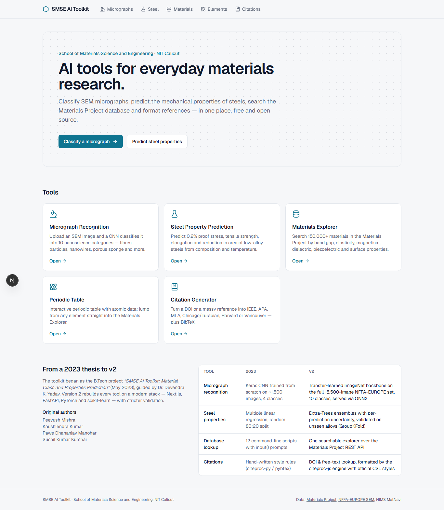
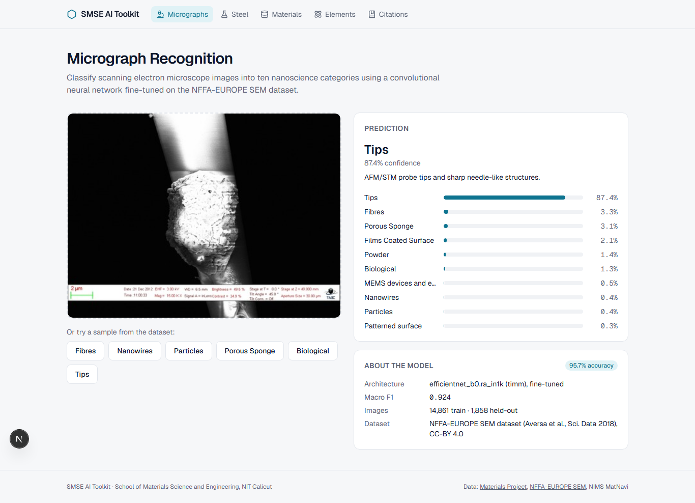
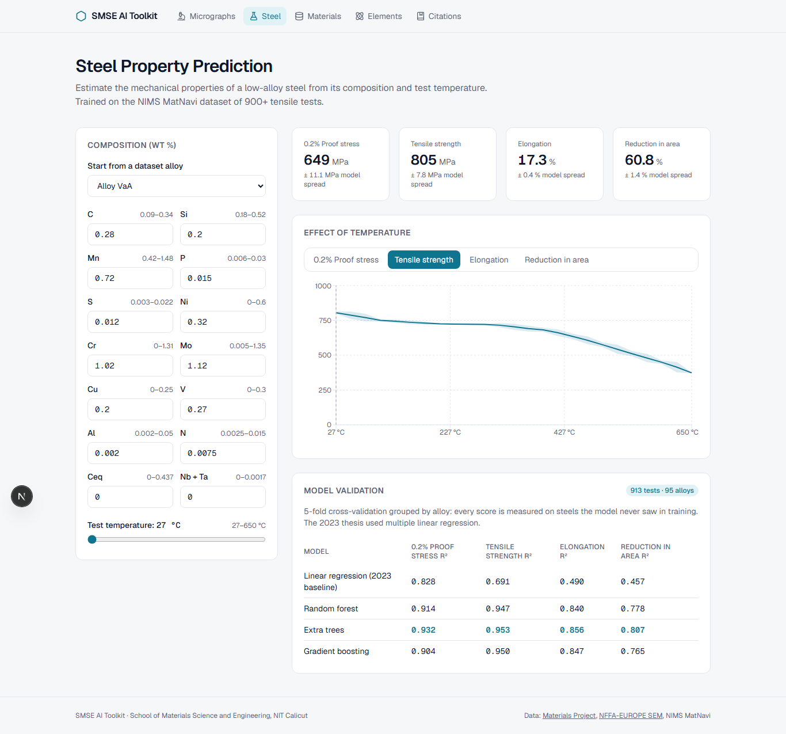
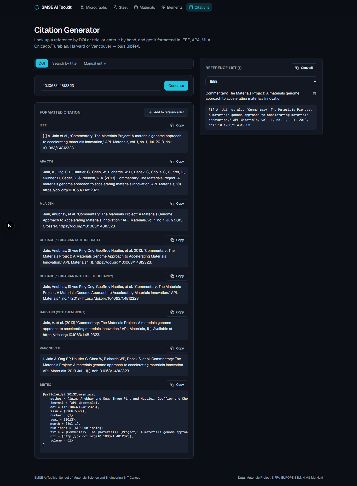
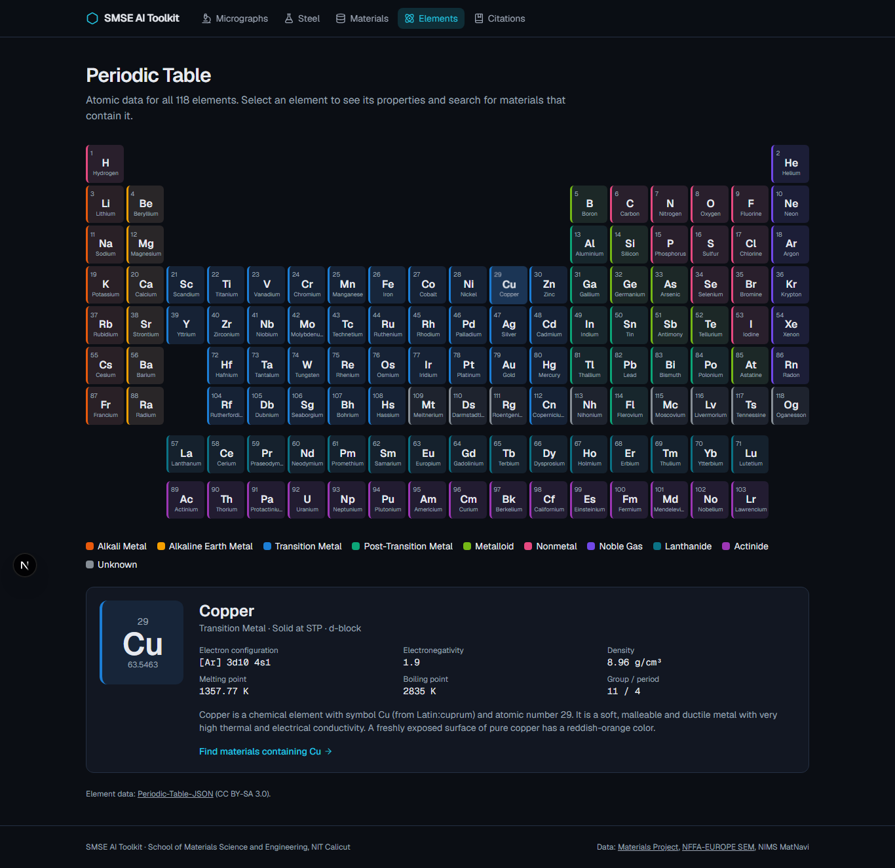

# SMSE AI Toolkit v2

AI tools for materials science, rebuilt from the 2023 B.Tech thesis
*“SMSE AI Toolkit: Material Class and Properties Prediction”* (School of Materials
Science and Engineering, NIT Calicut — Peeyush Mishra, Kaushlendra Kumar, Pawe
Dhananjay Manohar, Sushil Kumar Kumhar; guide Dr. Devendra K. Yadav). The thesis
is in [docs/](docs/SMSE_AI_Toolkit_Thesis_2023.pdf); the original Django code is
the first commit of this repository.

| Tool | What it does | How |
|---|---|---|
| **Micrograph Recognition** | Classifies SEM images into 10 nanoscience categories | EfficientNet-B0 fine-tuned on the NFFA-EUROPE SEM dataset (PyTorch); runs **in the browser** with ONNX Runtime Web |
| **Steel Property Prediction** | 0.2% proof stress, tensile strength, elongation, reduction in area from composition + temperature, with uncertainty | Extra-Trees ensembles (scikit-learn) on NIMS MatNavi data, validated on unseen alloys; evaluated **in the browser** |
| **Materials Explorer** | Search Materials Project by band gap, elasticity, magnetism, dielectric, piezoelectric and surface properties | Materials Project REST API via a serverless route |
| **Material pages** | Full properties, interactive 3D crystal structure, simulated powder XRD (6 X-ray sources), band structure + density of states, isostructural analogues | three.js; XRD computed in the browser (port of pymatgen's XRDCalculator, verified against it); band structures from the Materials Project open data |
| **Phase Diagram** | Binary convex hulls and ternary phase diagrams with tie-lines | Materials Project formation energies; lower convex hull computed in the browser |
| **Periodic Table** | Element data, links into the explorer | Static data |
| **Citation Generator** | DOI / title / manual entry → IEEE, APA, MLA, Chicago/Turabian, Harvard, Vancouver, BibTeX | Crossref + doi.org metadata, formatted with citation-js (citeproc-js) |



| Micrograph recognition | Steel property prediction |
|---|---|
|  |  |
| **Citation generator (dark mode)** | **Periodic table (dark mode)** |
|  |  |

## Results

**Micrograph recognition** — EfficientNet-B0, 10 classes, 18,577 SEM images (80/10/10
stratified split), 30 epochs with flips, 90° rotations, blur and random erasing; the
microscope data panel is cropped so the network never reads magnification text.
On the 1,858 held-out test images with 8-view test-time augmentation: **96.6 % accuracy,
macro-F1 0.950** (v1: 0.931). The smallest classes improved most — Fibres F1 0.84 → 0.89,
Porous sponge 0.80 → 0.94. The 2023 model reached 92–94 % on 4 classes.

**"Not recognised" detection** — max-softmax + k-nearest-neighbour feature distance
(threshold accepts 94 % of test micrographs). Flags 81 % of ordinary photos (CIFAR-10,
AUROC 0.96) but only 40 % of texture images (DTD, AUROC 0.80): textures can look like
microstructures, so the check is a warning, not a guarantee.

**Image analysis** — on synthetic microstructures with known ground truth: porosity
mean error 0.11 percentage points; grain size mean error 1.0 % (planimetric) and 1.5 %
(lineal intercept).

**Steel properties** — 913 tensile tests of 95 low-alloy steels; 5-fold cross-validation
grouped by alloy (every score is on steels never seen in training):

| Property | 2023 method (linear regression) R² | v2 (Extra Trees) R² | Mean abs. error |
|---|---|---|---|
| 0.2 % proof stress | 0.83 | **0.93** | 22 MPa |
| Tensile strength | 0.69 | **0.95** | 19 MPa |
| Elongation | 0.49 | **0.86** | 2.3 % |
| Reduction in area | 0.46 | **0.81** | 3.4 % |

## Stack

```
frontend/   The website (this is what gets deployed) — Next.js 16 · React 19 · TypeScript · Tailwind 4
  public/models/   browser models: micrograph.onnx, steel.bin/json
  src/lib/         in-browser inference (micrograph-model.ts, steel-model.ts), citation formatting
  src/app/api/     serverless routes: Materials Project + citation lookup
backend/    Python: model training (+ an optional FastAPI version of the API)
  ml/steel/        steel models: training + export to the browser format
  ml/micrograph/   dataset download, CNN training, ONNX export
  models/     trained models (micrograph.onnx, steel.joblib, metadata)
  data/       steel CSV + micrographs/ (18,577 SEM images, CC-BY 4.0, see its README)
docs/         thesis PDF and screenshots
```

Older uploads kept at the repository root for reference — `smse-toolkit-website.zip`
(the 2023 code) and `Dragon Real Estates.ipynb` — are not part of the build or deployment.
Deployment (free, Vercel only, no card) is described in [DEPLOY.md](DEPLOY.md).

## Run it locally (Windows)

Prerequisites: Node 20+ and pnpm. No Python needed to run the website.

```powershell
cd frontend
pnpm install
$env:MP_API_KEY = "your-materials-project-key"   # only needed for the Materials Explorer
pnpm dev                                         # http://localhost:3000
```

Tests: `pnpm test` (browser steel model vs. scikit-learn), `pnpm lint`, `pnpm build`;
Python tests: `cd backend; .venv\Scripts\python -m pytest`.

### Retraining (optional — trained models are already in the repo)

Training scripts write both `backend/models/` and the browser copies in `frontend/public/models/`.
Set up Python first: `cd backend; python -m venv .venv; .venv\Scripts\python -m pip install -r requirements.txt`.

Steel models: `.venv\Scripts\python -m ml.steel.train` (~10 s).

Micrograph model — ideally an NVIDIA GPU (about 70 min on a GTX 1650). The processed
dataset (18,577 images, ~800 MB) is already in `backend/data/micrographs/`:

```powershell
cd backend
.venv\Scripts\python -m pip install -r requirements-train.txt --index-url https://download.pytorch.org/whl/cu126 --extra-index-url https://pypi.org/simple
.venv\Scripts\python -m ml.micrograph.train      # writes models/micrograph.onnx + micrograph_meta.json
# To rebuild the dataset from the original source (~11.5 GB): .venv\Scripts\python -m ml.micrograph.download
```

Notes on the method:
- Images are stored at a 320 px short side; training runs at 224 px.
- The SEM data panel (scale bar, magnification, kV) at the bottom of each image is
  cropped before training and inference, so the model learns morphology rather than
  reading the instrument text.
- Random flips and 90° rotations replace the thesis's offline “data explosion”.
- Class-weighted loss handles the ~30× class imbalance; the reported numbers come
  from a stratified held-out test split never used for model selection.

### Tests

```powershell
cd backend;  .venv\Scripts\python -m pytest
cd frontend; pnpm lint; pnpm build
```

## Data and licences

- **NFFA-EUROPE SEM dataset** — Aversa et al., *Sci. Data* 5, 180172 (2018), CC-BY 4.0.
- **NIMS MatNavi low-alloy steel data** — via [Kaggle](https://www.kaggle.com/datasets/konghuanqing/matnavi-mechanical-properties-of-lowalloy-steels); `backend/data/raw/low_alloy_steels.csv`.
- **Materials Project** — Jain et al., *APL Materials* 1, 011002 (2013). Requires a free API key.
- **CSL styles** (`frontend/public/csl/`) — CC BY-SA 3.0, Citation Style Language project.
- **Element data** — [Periodic-Table-JSON](https://github.com/Bowserinator/Periodic-Table-JSON), CC BY-SA 3.0.
